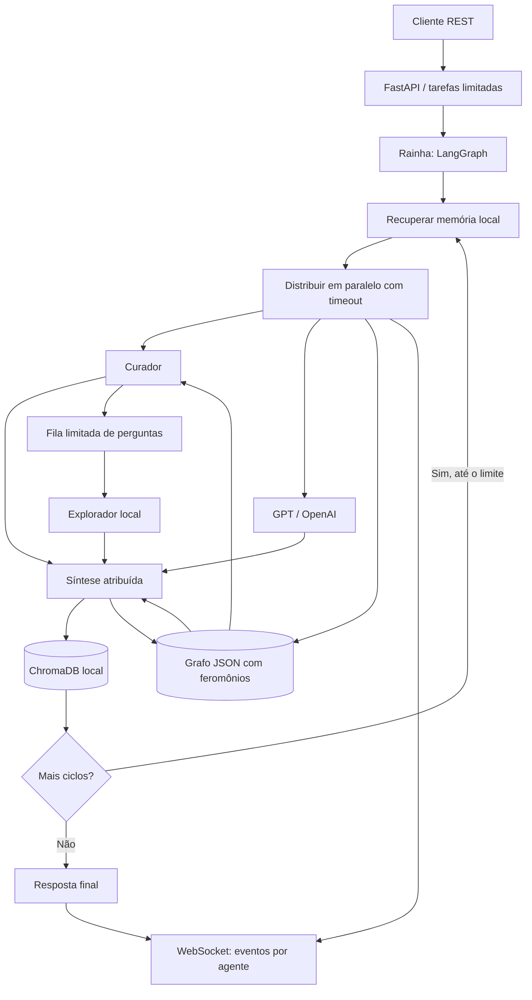

# HiveMind — A Mente Mestra

Orquestrador multiagente em Python 3.12+: Claude, GPT e Gemini trabalham como
“formigas”, coordenadas por uma “rainha” que reúne contribuições e preserva
conhecimento local para consultas posteriores.

**Escopo honesto:** este projeto é uma base executável e testável, não uma
certificação enterprise ou governamental. “Aprender” significa recuperar e
reutilizar contexto armazenado; não treinar modelos, garantir respostas melhores
nem aumentar inteligência de forma ilimitada. Nenhum agente executa comandos,
controla aplicativos ou recebe acesso ao celular.

## Arquitetura



- **Agentes:** interface assíncrona extensível, SDKs oficiais e modo demo offline.
- **Grafo:** recuperação → distribuição → síntese → memória → novo ciclo limitado.
- **Síntese:** reúne contribuições identificadas; não declara consenso sem avaliação.
- **Memória:** Chroma embutido, persistente, embeddings locais determinísticos por
  hashing de tokens. Não baixa modelos nem envia dados a serviços de embeddings.
  Essa busca lexical vetorial é simples e não equivale a embeddings semânticos.
- **Grafo de conhecimento:** fragmentos locais são conectados por termos em comum.
  Cada trilha recebe feromônio, pode ser reforçada quando uma descoberta é útil e
  evapora ao fim de cada geração; conexões fracas e nós isolados podem ser podados.
- **Papéis da colônia:** o explorador usa um provedor plugável (incluindo a
  simulação local), o sintetizador conecta descobertas e o curador avalia seu
  valor e decide se uma nova pergunta deve entrar na fila.
- **Propagação controlada:** perguntas semelhantes são deduplicadas, a fila tem
  capacidade limitada e cada tarefa respeita uma profundidade máxima. Não há
  criação de processos ou agentes sem limite.
- **Falhas:** um piloto pode falhar sem interromper os demais; falha de todos
  encerra a tarefa. Erros de persistência não são apresentados como aprendizado.
- **Streaming:** eventos com respostas completas de cada piloto, não tokens.
- **Orçamentos:** limites de tokens solicitados por chamada e 16.000 caracteres
  por contribuição; contexto compartilhado de até 24 trechos,
  8.000 caracteres por trecho e 32.000 no total. Cortes recebem uma indicação
  explícita; os limites evitam crescimento recursivo sem controle.

## Instalação e execução

Requisitos: Python 3.12+, [uv](https://docs.astral.sh/uv/) ou Docker Compose.

```bash
uv sync --frozen
cp .env.example .env
uv run uvicorn hivemind.api.app:create_app --factory --host 127.0.0.1 --port 8000
```

O modo demo vem habilitado, dispensa chaves e não faz chamadas aos provedores.
Abra `http://127.0.0.1:8000/docs` para a documentação OpenAPI interativa.

### Simulação offline da colônia

O comando abaixo executa cinco gerações locais sem chaves de API, rede ou
chamadas aos provedores de modelos. Cada geração mostra nós criados, trilhas
reforçadas e perguntas geradas/consumidas.

```bash
uv run python -m hivemind run --cycles 5
# Ou, depois de instalar o projeto: hivemind run --cycles 10
```

O grafo é persistido em `HIVEMIND_GRAPH_PATH` (padrão
`data/knowledge_graph.json`). A simulação aceita de 1 a 100 ciclos; a fila
continua limitada a 100 perguntas e a profundidade de propagação é limitada ao
número de ciclos solicitado. Os dados são locais e devem ser tratados como
conteúdo não verificado. Para começar de novo, remova o arquivo do grafo.

```bash
curl -X POST http://127.0.0.1:8000/tasks \
  -H 'Content-Type: application/json' \
  -d '{"task":"Como organizar um projeto de pesquisa?","cycles":2}'
# HTTP 202: {"id":"...","status":"queued","result":null,"error":null}

curl http://127.0.0.1:8000/tasks/ID_DA_TAREFA
curl http://127.0.0.1:8000/metrics
curl http://127.0.0.1:8000/health
```

`GET /tasks/{id}` retorna `queued`, `running`, `completed`, `failed` ou `cancelled`,
com resultado final ou erro sanitizado. As execuções são serializadas: uma tarefa
aceita fica `queued` até a anterior terminar e só então passa a `running`
(evento `started`). O resultado inclui `answer`, `responses`,
`failures`, `cycles` e `memory_ids`. Use o ID recebido, sem as chaves do exemplo.
Tarefas vazias, longas demais ou com ciclos além do limite são rejeitadas (422);
capacidade esgotada retorna 429. Os limites são configuráveis no `.env`.

### WebSocket

Conecte-se a `ws://127.0.0.1:8000/ws/tasks/ID_DA_TAREFA`. Eventos retidos são
reproduzidos e os novos chegam conforme os agentes respondem. `task_finished`
contém o estado final e encerra a conexão. Clientes lentos podem perder eventos
intermediários; consulte o REST para obter o resultado definitivo.

Exemplo Python com `websockets` (já presente no ambiente bloqueado):

```python
import asyncio
import json
import os
from websockets.asyncio.client import connect

async def main():
    token = os.getenv("HIVEMIND_API_TOKEN")
    headers = {"Authorization": "Bearer " + token} if token else {}
    async with connect(
        "ws://127.0.0.1:8000/ws/tasks/ID_DA_TAREFA",
        additional_headers=headers,
    ) as socket:
        async for message in socket:
            print(json.loads(message))

asyncio.run(main())
```

Não são aceitos tokens em URLs, cookies ou conexões WebSocket com `Origin`
(navegador). Integração web requer um backend intermediário autenticado; não
coloque chaves de provedores ou tokens administrativos em JavaScript público.

## Provedores reais e configuração

Todas as opções estão documentadas em [`.env.example`](.env.example), com prefixo
`HIVEMIND_`. A configuração é validada na inicialização.

1. Configure `HIVEMIND_DEMO_MODE=false`.
2. Gere um token local: `python -c 'import secrets; print(secrets.token_urlsafe(32))'`.
   Salve-o em `HIVEMIND_API_TOKEN` (mínimo 32 caracteres).
3. Configure ao menos uma chave: `HIVEMIND_ANTHROPIC_API_KEY`,
   `HIVEMIND_OPENAI_API_KEY` ou `HIVEMIND_GOOGLE_API_KEY`.
4. Ajuste os nomes de modelos para os disponíveis na sua conta e reinicie.
5. Envie o header `Authorization` com esquema `Bearer` e o token nos endpoints de tarefas, métricas
   e no handshake WebSocket. `/health` e documentação não exigem autenticação.

Somente provedores com chave configurada são ativados. Limites da conta, custos,
disponibilidade dos modelos e políticas de retenção dos provedores continuam
aplicáveis. Cada ciclo pode fazer uma chamada por agente; não existe loop infinito.

## Memória, retroalimentação e métricas

Dados ficam em `HIVEMIND_MEMORY_PATH` (padrão `data/chroma`). Respostas dos ciclos
anteriores e registros relevantes podem ser reutilizados. Resultados são
conteúdo não verificado: podem conter erros ou instruções maliciosas e nunca
devem ser tratados como política de sistema. Revise respostas antes de decisões
sensíveis; não envie segredos ou dados pessoais desnecessários.

`GET /metrics` informa contadores de ciclos, tarefas, falhas de agentes e
quantidade atual de registros. São medidas operacionais, não provas de ganho
de qualidade. Contadores reiniciam com o processo; a memória persiste. A
simulação CLI informa suas métricas por geração e mantém o grafo JSON entre
execuções.

A retenção de tarefas/eventos é limitada em RAM: registros terminados mais antigos
são removidos ao atingir a capacidade. Tarefas/status não sobrevivem a reinícios.
A memória vetorial cresce com o uso e **não tem expiração automática**: monitore
disco, estabeleça política de retenção e faça backup consistente com o serviço
parado. Para apagar toda a memória, pare o serviço e remova o diretório de dados
(ou volume Docker). Não abra bancos recebidos de terceiros.

## Segurança e limites de implantação

- O padrão sem autenticação existe **apenas para demo local**. Configure token
  também em demo antes de permitir acesso compartilhado.
- Use TLS, proxy com limites de corpo/requisições, proteção de rede, gerenciamento
  de segredos, quotas de custo e monitoramento antes de expor o serviço.
- O token compartilhado não implementa usuários, RBAC ou isolamento entre tenants:
  quem tem o token acessa todas as tarefas e a mesma memória.
- Execute **um processo/worker e uma réplica** por diretório de memória.
  O agendamento é local, não uma fila distribuída durável. Os pilotos de uma
  tarefa trabalham em paralelo; o motor serializa tarefas para manter a
  retroalimentação determinística. O limite de tarefas ativas também limita
  aquelas aguardando o motor.
- Prompts, respostas e credenciais não são incluídos nos logs operacionais JSON.
  Não habilite logs HTTP/SDK detalhados ou tracing externo com dados sensíveis.
- `.env`, dados, cobertura e caches são ignorados pelo Git. A imagem não copia
  `.env`, testes, histórico Git ou dados locais.
- **ChromaDB 1.5.9 tem alertas conhecidos sem correção disponível** sobre
  autorização multi-tenant e injeção de código no modo servidor/configuração de
  embeddings. Aqui só se utiliza `PersistentClient` local, sem servidor Chroma,
  sem aceitar configuração de embeddings por API e sem importar persistência
  não confiável. Isso reduz a superfície, mas não certifica ausência de risco:
  reavalie os avisos e versões antes de produção. Não publique uma porta Chroma.

## Docker

```bash
docker compose up --build
# API: http://127.0.0.1:8000 ; volume hivemind-data para a memória
docker compose down
# ATENÇÃO: down -v também apaga a memória persistente
```

O container roda como usuário não privilegiado, com filesystem raiz somente
leitura e volume gravável para dados. O Compose publica a porta apenas no
loopback do host. Configure segredos via ambiente/gerenciador de segredos,
nunca por `COPY` ou argumentos de build.

## Desenvolvimento e qualidade

```bash
uv sync --frozen
uv run ruff check .
uv run black --check .
uv run mypy src/hivemind
uv run pytest --cov=hivemind --cov-report=term-missing --cov-report=xml
```

Os testes usam mocks de SDKs, agentes falsos e diretórios temporários, sem chaves
ou rede. Cobrem conectores, ciclos, memória, isolamento de falhas, API, autenticação
e eventos. O CI executa lint, formatação, tipos e testes com cobertura.
`pyproject.toml` fixa dependências diretas; `uv.lock` fixa também as transitivas.

### Estrutura

```text
src/hivemind/
  agents/       # Papéis explorador, sintetizador e curador; conectores demo/SDK
  core/         # Grafo LangGraph e ciclos da colônia
  memory/       # Grafo JSON com feromônios e busca vetorial local
  feedback/     # Fila limitada de perguntas e métricas de retroalimentação
  __main__.py   # Interface CLI para simulação offline
  api/          # FastAPI REST/WebSocket
  config.py     # Configuração validada por ambiente
  logging.py    # Logs JSON operacionais
tests/          # Testes offline
```

Para adicionar um piloto, implemente `BaseAgent.generate(task, context)` e
`close()`, defina um nome único e inclua-o na fábrica de agentes. Acrescente
testes com mocks e documentação das variáveis necessárias.
